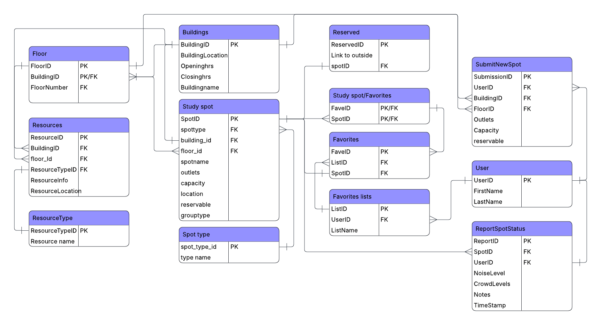

# Nook

**Working on the code?** Start with the [team file guide](docs/FILE_GUIDE.md) for file roles, labeled code sections, map/ID conventions, storage boundaries, SQL variants, and commands.

## App Summary

College students frequently struggle to find campus study spaces that accommodate their specific needs, especially when trying to coordinate a spot for a group. Without a reliable way to check space layouts, typical noise levels, or nearby amenities in advance, students waste valuable time wandering around and between buildings. This often leads to individuals and groups settling for unsatisfactory environments that negatively impact their overall productivity. To solve this, our app provides a comprehensive interactive map of campus study spaces designed to help students pinpoint an ideal spot, whether they are planning ahead or actively searching within a crowded building. Users can explore detailed floor plans of popular buildings and apply custom filters for group capacity, privacy requirements, general noise levels, and available outlets. As a supplementary feature, the platform incorporates user-submitted status reports, allowing students to share near real-time crowding conditions to enhance the app's historical busyness data. Ultimately, the app eliminates the guesswork of finding a study spot, ensuring students can quickly secure an environment tailored to their exact needs.

This prototype uses illustrative inventory and historical data; reports are loaded on page refresh, not streamed live.

HBLL uses ten supplied drawings, WSC uses nine, and JKB uses four (floors 1–4). All are searchable, zoomable SVG maps. Study-spot pins remain provisional.

The campus overview traces 45 labeled buildings from the supplied map. Blue JKB, HBLL, and WSC shapes open floor maps; all other buildings show a coming-soon message. Zoom, drag/swipe, and reset are available. Raised building edges are illustrative, not measured heights.

## ERD



This slice uses six ERD tables: `Buildings`, `Floors`, `SpotType`, `Study Spot`, `User`, and `ReportSpotStatus`. Buildings contain floors; study spots reference a building, floor, and type; reports reference a spot and user. All six contain sample rows. Other ERD entities remain outside this slice.

## Tech Stack

- **Frontend:** hand-built HTML, CSS, JavaScript, and SVG floor maps.
- **Backend/database:** Supabase's REST API and PostgreSQL, with row-level security.
- **Local server:** Node.js loads connection settings from `.env` and serves the app.

This approach keeps our custom map interface easy to edit while Supabase handles database hosting and API access.

## How to Get It Running

1. Clone this repository, or extract `StudyBYUProduct.zip`. Open the `StudyBYUProduct` folder containing `package.json` in VS Code.
2. Install Node.js 22 or newer. Use the team's existing Supabase project; its database setup is complete. **Do not rerun sample-data scripts.**
3. Copy `.env.example` to `.env` beside `package.json`. Enter the project URL and its browser-safe publishable key:

   ```dotenv
   SUPABASE_URL=https://YOUR_PROJECT.supabase.co
   SUPABASE_PUBLISHABLE_KEY=sb_publishable_YOUR_KEY
   SUPABASE_REPORTS_TABLE=ReportSpotStatus
   ```

   `.env` is Git-ignored. Never commit real settings or use a secret/service-role key.
4. In VS Code's terminal, run `npm run check:db`. Both report-table and latest-view checks should pass. Then run `npm start`; no dependency installation is required to start the app.
5. Open [http://127.0.0.1:3000](http://127.0.0.1:3000). Keep the terminal running. If port 3000 is busy, stop the old server or run `$env:PORT="3001"` in PowerShell before `npm start`, then open port 3001.

## Verifying the Vertical Slice

### Sharing the complete project on GitHub

Extract the ZIP and upload the **contents of StudyBYUProduct**, preserving `assets/`, `docs/`, `supabase/`, `tests/`, and `tools/` as folders. Keep `index.html`, `app.js`, `database.js`, `auth.js`, `styles.css`, and all three `*-plans.js` files together at the repository root. Uploading only HTML or flattening the folders breaks the maps, ERD, and commands. Include `.gitignore` and the blank `.env.example`, never `.env` or `node_modules`. GitHub Desktop is the easiest way to preserve folders and hidden files.

GitHub stores the source; GitHub Pages cannot run `server.mjs` or read `.env`. For the database demo, teammates must clone the complete project and follow the running instructions above. A public database-enabled app requires a Node-capable host, not Pages.

### Test the report

1. Select **WSC → Floor 1 → East → East hall tables (sample)**, then click **Choose this spot**.
2. Choose noise and crowding levels, enter a distinctive fictional note such as `Refresh proof 42`, and click **Confirm report**.
3. The app inserts into `ReportSpotStatus` and displays the saved values and database-generated report ID. Reopen the spot to see **Latest report**.
4. Refresh the entire page and reopen that same spot. The note and report ID should remain: the app reads them again from `latest_report_spot_status`, not browser storage.
5. Confirm that same report ID exists in Supabase's `ReportSpotStatus` table.

Noise/crowding use **1 = Low, 2 = Medium, 3 = High**. The test spot uses ID **1008**, and reports use fictional demo user **1001**. Database reporting covers non-reservable built-in sample spots; favorites and user-added spot suggestions remain local.

For the assignment, record only the button, changed UI, and refresh proof in a video under two minutes. Submit the video link and public repository/README link; check both in a private browser window.

## AI-tagged crowd/noise reports

Signed-in users report a space; the `tag-report` Edge Function asks Gemini to tag noise and crowd (low/medium/high) and flag spam. Pins and filters show only approved reports from the last 45 minutes, otherwise "No recent data". Guests still post to the legacy `ReportSpotStatus` table, which does not feed pins.

- Migration: `supabase/migrations/20261109_001_ai_tagged_reports.sql` (`spot_reports`, rate limit of 3 per user per space per hour, `space_conditions()` RPC).
- Function: `supabase/functions/tag-report/`. The only provider-specific code is `llm.ts`; swap Gemini for Groq by replacing `classify()`.
- Secrets (never in the repo): `supabase secrets set GEMINI_API_KEY=... CRON_SECRET=... [GEMINI_MODEL=...]`. Check current free-tier limits in Google AI Studio.
- Failures (429, timeout, bad output) leave the report `pending`. Retry with `POST /functions/v1/tag-report {"retry":true}` and header `x-cron-secret`, manually or from pg_cron (10 reports per run, max 5 attempts).
- Staleness window: change the default in `space_conditions()` and `loadConditions()` in `database.js`.
