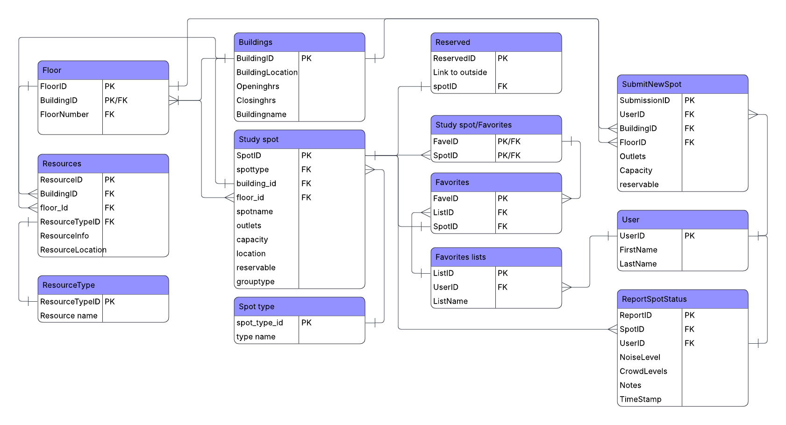
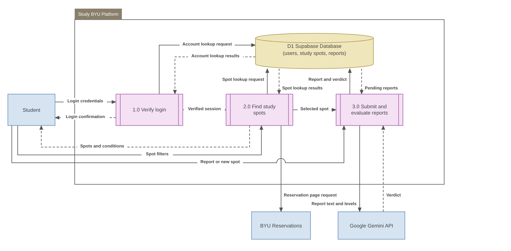

# Nook — BYU Study Spot Finder

[Open the live site](https://byunook.vercel.app/) · [GitHub repository](https://github.com/crehks/IS401byustudyspots)

Nook helps BYU students find a study spot that fits their needs. This README covers the app, its data model and data flows, the stack, local setup, deployment, and how to verify that a report persists.

## App Summary

BYU students can spend time walking between buildings because they cannot tell which study spaces fit their needs. Nook provides a campus map and searchable floor plans for the Harold B. Lee Library (HBLL), the Wilkinson Student Center (WSC), and the Joseph F. Smith Building (JKB). Students can filter spaces by individual or group use, capacity, noise level, privacy, and outlets, and search for rooms and resources. A selected spot includes its floor, location details, reservation information when available, and recent reports. Students can save spots in lists and report whether a spot was available, along with current noise and crowding. Signed-in reports enter an AI review workflow, while guest reports use the legacy report table. An admin-only Impact page displays four key results calculated from recorded app activity. Some inventory and pin locations are still illustrative, so the map is a study guide rather than a guarantee of current availability.

The campus overview shows 45 labeled buildings. HBLL, WSC, and JKB open supplied SVG floor plans; other buildings show a coming-soon message. The map supports zoom and pan, and study-spot pins are provisional. Reports are loaded when the page refreshes rather than streamed live.

## How to Use the App

Open [the live site](https://byunook.vercel.app/) in a browser.

1. **Explore campus.** Select HBLL, WSC, or JKB on the campus map to open its building view.
2. **Find spots.** Choose a floor, adjust the study filters, and review the matching spots. On mobile, switch between the map and the spot list. Select a spot card or map pin to see its details.
3. **Head to a spot and share conditions.** Select **Head Here**, then **I've Arrived** when you reach it. The arrival form lets you report whether you found a seat, the current crowding and noise, and an optional note.
4. **Save spots.** Sign in to save spots in **Favorites** or custom lists under **My Nooks**.
5. **Suggest a spot.** Select **Report a Spot** in the navigation, fill in the details, and submit it for team review. New suggestions remain pending until reviewed.
6. **Admin tools.** Admin accounts have access to the development tools and the Impact dashboard.

## ERD

The following logical ERD is embedded as required by the Module 5 README assignment.



The diagram uses crow's-foot notation: a single bar means one, and a crow's foot means many. Examples include Building 1-to-many Floor, Study Spot 1-to-many ReportSpotStatus, and FavoritesList many-to-many Study Spot through Favorites.

The ERD captures the team's logical model. The implementation has since gained additional tables and separate report paths; follow the current schema notes in [docs/YOUR_EXISTING_TABLES.md](docs/YOUR_EXISTING_TABLES.md) and migrations under [supabase/migrations](supabase/migrations/) when working with the deployed database.

## Data Flow Diagrams

These diagrams are embedded to meet the final presentation assignment's README requirement.

### Level 0


The context diagram shows students, Nook, the Gemini API, and BYU Reservations as external actors or systems.

### Level 1


The expanded diagram shows login, browsing, report and spot submissions, record maintenance, and AI report tagging.

### Level 1 logical



## Tech Stack

| Layer | Technology | Purpose |
| --- | --- | --- |
| Front end | HTML, CSS, JavaScript, and SVG | Custom responsive interface, interactive campus map, and floor plans |
| Static hosting | Vercel | Serves the web app from the repository using [vercel.json](vercel.json) |
| Database and API | Supabase / PostgreSQL | Stores study spots, reports, favorites, OKR events, and related data; exposes the API used by the app |
| Authentication | Supabase Auth | Supports signed-in reporting and account-based saved lists |
| AI automation | Google Gemini through a Supabase Edge Function | Classifies signed-in report text, validates the report, and assigns noise and crowding levels |
| Local development | Node.js 22+ | Runs the small local server in [server.mjs](server.mjs), which reads optional local settings and serves the app |

This stack keeps the maps and interface easy to modify while Supabase provides the hosted database, authentication, and function runtime. Vercel serves the front end; it does not run the Supabase Edge Function.

## Data and Persistence

| Data | When Supabase is connected | Local preview or offline behavior |
| --- | --- | --- |
| Signed-in study-spot reports | Saved in `spot_reports`; sent through AI review | Reports cannot enter the AI workflow without a signed-in account and database connection |
| Guest study-spot reports | Saved in `ReportSpotStatus`; this legacy path is not AI-reviewed | Saved in browser storage only when the database is unavailable |
| Saved lists | Saved in `FavoritesList` and `Favorites` for signed-in users | Saved in this browser's local storage |
| New spot suggestions | Inserted as pending rows in `SpotSubmission` for team review; they do not appear in the catalogue automatically | Saved only in this browser's local storage |
| Accounts | Managed by Supabase Auth; the app stores a browser session, not passwords in its own tables | Sign-in and account-backed features are unavailable |
| OKR activity | Stored as database events and returned as aggregates to the protected dashboard | No cloud OKR activity is recorded |

### Pages and views

The main site is a single-page application. `index.html` contains the **Explore**, **Building**, **My Nooks**, and **Profile** views; **Report a Spot** opens a form from the main site. The separate [admin.html](admin.html) provides protected development and catalogue tools, and [okr.html](okr.html) provides the protected Impact dashboard. The project has three top-level HTML files, with additional screens implemented as views inside `index.html`.

## How to Get It Running

### Local development

1. Clone the [repository](https://github.com/crehks/IS401byustudyspots) and open its folder in VS Code.
2. Install Node.js 22 or newer.
3. The repository includes browser-safe Supabase settings in [supabase-config.js](supabase-config.js) for the team's project. To use a different Supabase project locally, copy `.env.example` to `.env` and set:

   ```dotenv
   SUPABASE_URL=https://YOUR_PROJECT.supabase.co
   SUPABASE_PUBLISHABLE_KEY=sb_publishable_YOUR_KEY
   SUPABASE_REPORTS_TABLE=ReportSpotStatus
   ```

   The `.env` file is ignored by Git. Use only a publishable key in browser code; never add a secret or service-role key to the front end or repository. The app relies on Supabase row-level security (RLS) to protect data.
4. In a terminal in the project folder, run:

   ```bash
   npm start
   ```

   No package installation is needed to run the app. The local server reads `.env` when present and listens on `127.0.0.1:3000`.
5. Open [http://127.0.0.1:3000](http://127.0.0.1:3000). Keep the terminal open while using the site. If port 3000 is busy, set `PORT` to another available port before starting the server.

To check a custom local Supabase configuration, fill in `.env` and run:

```bash
npm run check:db
```

This read-only check validates the connection and reads the report table and latest-report view. It does not submit a report or create tables. For setup against the team's existing schema, follow [docs/YOUR_EXISTING_TABLES.md](docs/YOUR_EXISTING_TABLES.md); do not rerun seed or setup scripts against the live project.

### Vercel deployment

The live app is [byunook.vercel.app](https://byunook.vercel.app/). Vercel serves the static HTML, CSS, JavaScript, and assets described in `vercel.json`; `server.mjs` is for local development. The browser loads the public Supabase configuration from `supabase-config.js`. Supabase migrations and Edge Functions are deployed separately from the Vercel front end.

For a separate deployment, connect the repository to a Vercel project and deploy from the repository root. Update `supabase-config.js` to the intended Supabase project using its URL and publishable key. Apply the matching database migrations and configure the Supabase Edge Function secrets described below. Do not put a service-role key in Vercel's static files or any browser-visible setting.

## Verifying the Vertical Slice

This section follows the Module 5 assignment's vertical-slice requirement: submit a report, confirm the interface response, refresh the page, and confirm that the database row remains.

1. Configure the intended Supabase connection. `npm run check:db` checks the legacy `ReportSpotStatus` table and its latest-report view; it does not verify the AI function.
2. Open a built-in, non-reservable study spot, such as **WSC → Floor 1 → East → East hall tables**.
3. Choose **Head Here**, then **I've Arrived**. Submit whether the spot was available, its current noise and crowding, and an optional fictional note.
4. For the original guest vertical slice, submit while signed out. The app saves the report to `ReportSpotStatus`; after a full refresh, reopen the spot and confirm the latest report is still shown. In Supabase Table Editor, confirm the row remains.
5. To verify the AI path, submit while signed in. Confirm the row in `spot_reports`, then check its status. Approved reports can update the recent crowding/noise forecast for 45 minutes; pending and rejected reports persist but do not contribute to public conditions.

Use fictional test notes and avoid personal information. The spot catalogue and some placements are prototypes; reports describe a student's observation at a point in time, not guaranteed occupancy. For previous checks and their scope, see [docs/verification.md](docs/verification.md).

## AI Workflow Automation

The signed-in report workflow is implemented in [supabase/functions/tag-report](supabase/functions/tag-report/):

1. An authenticated student submits report text and self-selected noise/crowding levels.
2. The app writes the report as `pending` in `spot_reports`.
3. The Supabase Edge Function sends the report text and selected levels to Google Gemini. Gemini returns structured labels for validity, noise, crowding, and a short reason.
4. Valid reports become `approved`; invalid or spam-like reports become `rejected`. Approved reports can contribute to recent conditions for the spot. The conditions aggregate uses approved reports from the latest 45 minutes.
5. If Gemini fails or returns unusable output, the report stays pending for retry rather than being treated as approved.

The database limits authenticated users to three reports per spot per hour. Guests use the separate legacy `ReportSpotStatus` table and do not enter the AI review flow.

To configure this workflow in a separate Supabase project, apply the appropriate migrations and deploy the `tag-report` function. Set `GEMINI_API_KEY` and `CRON_SECRET` as Supabase Function secrets; optional model overrides are `GEMINI_MODEL` and `GEMINI_FALLBACK_MODEL`. Never commit these secrets. See [docs/YOUR_EXISTING_TABLES.md](docs/YOUR_EXISTING_TABLES.md) and the function source for the project-specific setup.

## Objectives and Key Results

The protected Impact dashboard at [okr.html](okr.html) displays four key results from Supabase aggregates. Baselines and targets are defined in [okr.js](okr.js); current values come from recorded activity through the `okr_metrics()` function. The dashboard polls for updates every five seconds. It does not use hard-coded current results.

| Objective | Key result | Baseline → target | How it is measured |
| --- | --- | --- | --- |
| Reduce friction and frustration by showing spots that fit students' needs | **O1-KR1:** Increase the share of arrival reports that say a spot was available | 0% → 50% | Yes answers divided by all answered arrival-availability questions |
| Reduce friction and frustration by showing spots that fit students' needs | **O1-KR2:** Reduce the average time to choose a study spot | 3 minutes → 60 seconds | Average seconds recorded from app entry to a spot-choice action |
| Provide a consistent, quality experience for long-term users | **O2-KR1:** Increase registered users who return at least twice within 14 days | 0% → 50% | Registered users with at least two recorded visits in the rolling 14-day window, divided by all registered users |
| Provide a consistent, quality experience for long-term users | **O2-KR2:** Increase registered users who submit more than one report within 14 days | 0% → 40% | Registered users with at least two reports in the rolling 14-day window, divided by all registered users |

The database returns aggregates only to an authorized admin session; the browser does not read the raw visit and choice-event tables. The target values are goals, not claims about current performance.

## Definition of Done and Accessibility

The final-project assignment calls for five functional pages, all four OKRs tracking real activity, at least one working AI automation, responsive desktop and mobile layouts, end-to-end functionality, an Accessibility score of at least 90 in Lighthouse, embedded Level 0 and Level 1 DFDs in this README, a cloud-hosted site, and code merged to `main`.

Lighthouse Accessibility results provided by the team:

| Page | Device | Score |
| --- | --- | ---: |
| Main page | Desktop | 96 |
| Main page | Mobile | 96 |
| Impact | Not specified | 100 |
| Dev tools | Not specified | 100 |

All reported scores meet the 90-point Accessibility target. The measurement date and browser version were not provided.

## Project Notes

- [docs/FILE_GUIDE.md](docs/FILE_GUIDE.md) explains the main files, map IDs, data storage boundaries, and safe editing practices.
- [docs/YOUR_EXISTING_TABLES.md](docs/YOUR_EXISTING_TABLES.md) covers the team's existing Supabase schema and report persistence flow.
- [docs/verification.md](docs/verification.md) records historical checks and their limits; check its dates before treating a result as current.
- `supabase/migrations/` contains the database changes; review the matching migration before applying anything to a Supabase project.
- Prototype building inventory and map placements are illustrative. Crowding is based on user reports and does not mean live head counts.

## Automated Checks

Install the development dependencies before running the repository checks:

```bash
npm ci
npm test
npm run test:admin
```

The automated checks use local fixtures. They do not verify that the currently hosted Vercel deployment, Supabase project, or Gemini function is reachable.
