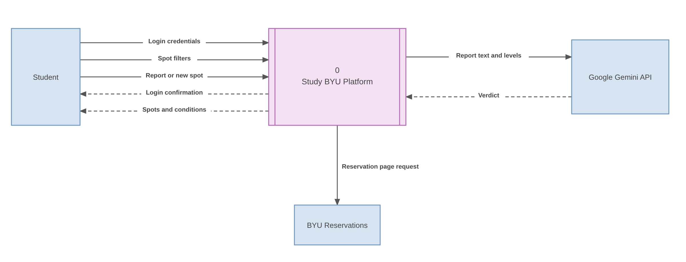
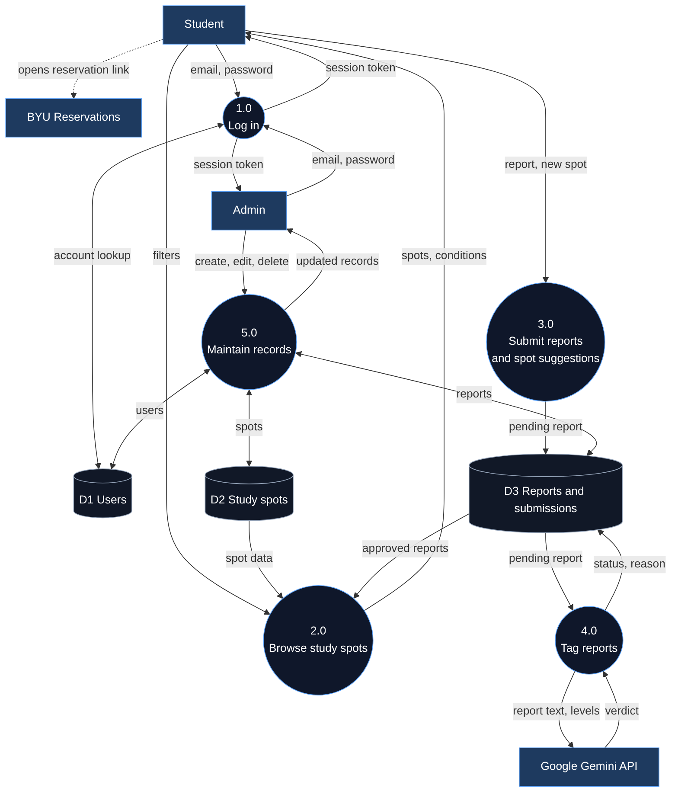

# Nook

## App Summary

College students frequently struggle to find campus study spaces that accommodate their specific needs, especially when trying to coordinate a spot for a group. Without a reliable way to check space layouts, typical noise levels, or nearby amenities in advance, students waste valuable time wandering around and between buildings. This often leads to individuals and groups settling for unsatisfactory environments that negatively impact their overall productivity. To solve this, our app provides a comprehensive interactive map of campus study spaces designed to help students pinpoint an ideal spot, whether they are planning ahead or actively searching within a crowded building. Users can explore detailed floor plans of popular buildings and apply custom filters for group capacity, privacy requirements, general noise levels, and available outlets. As a supplementary feature, the platform incorporates user-submitted status reports, allowing students to share near real-time crowding conditions to enhance the app's historical busyness data. Ultimately, the app eliminates the guesswork of finding a study spot, ensuring students can quickly secure an environment tailored to their exact needs.

**Live site:** https://byunook.vercel.app (Vercel, backed by Supabase).

This prototype uses illustrative inventory and historical data; reports are loaded on page refresh, not streamed live.

HBLL uses ten supplied drawings, WSC uses nine, and JKB uses four (floors 1–4). All are searchable, zoomable SVG maps. Study-spot pins remain provisional.

The campus overview traces 45 labeled buildings from the supplied map. Blue JKB, HBLL, and WSC shapes open floor maps; all other buildings show a coming-soon message. Zoom, drag/swipe, and reset are available. Raised building edges are illustrative, not measured heights.

## How to Use the App

No setup is needed to try it: open **https://byunook.vercel.app** in any browser.

1. **Explore the campus map.** The home page shows 45 BYU buildings. Click a blue building (HBLL, WSC, or JKB) to open its floor plans. Other buildings show a "coming soon" message. Drag to pan, scroll or pinch to zoom, and use **Reset** to recenter. On a phone, tap **Interact with map** to drag and zoom; tap **Done** to scroll the page again.
2. **Pick a floor.** Choose a floor tab to see its study-spot pins. Each pin shows how many seats the spot has.
3. **Filter spots.** Set group size, privacy, noise level, and outlets. The match count updates as you change filters, and **Clear** resets them. On mobile, switch between **Map** and **Study spots** to see results as a list.
4. **Open a spot.** Click a pin or a search result to see its details, including the latest crowd and noise report ("No recent data" if nobody has reported in the last 45 minutes).
5. **Choose a spot and report conditions.** Click **Choose this spot**, set noise and crowding, add an optional note, and click **Confirm report**. Other students see this the next time they load the page.
6. **Create an account (optional).** Click **Log in**, then sign up with your email and confirm it from the link we send you. Signed-in users can save spots to **Favorites** and custom lists under **My Nooks**, and their reports are checked by AI before they affect the map.
7. **Report a new spot.** Click **Report a Spot** in the navigation to open its own page (`/report.html`); no account is needed. Pick a building and floor plan, click the plan to drop a pin (drag it to fine-tune), fill in the spot details, and send it. Reports wait as pending until the team reviews them, so they do not appear on the map right away. Signed-in users can open the **Recent reports** tab on that page to see each report as Pending, Added, or Denied, with filters for each.
8. **Admins only.** Admin accounts see extra menu items: **Dev tools** (`/admin.html`: Maintain Users, Maintain Records, and floor-plan pin editors, unlocked with an admin code) and **Impact** (`/okr.html`: objectives and key results computed from real app activity).

## ERD


The core schema uses six ERD tables: `Buildings`, `Floors`, `SpotType`, `Study Spot`, `User`, and `ReportSpotStatus`. Buildings contain floors; study spots reference a building, floor, and type; reports reference a spot and user. All six contain sample rows. Later migrations in `supabase/migrations/` add accounts, favorites, spot submissions, AI-tagged reports (`spot_reports`), OKR tracking, and the admin gate.

## Data Flow Diagrams

**Level 0 (context diagram)**



**Level 1 (processes and data stores)**



**Level 1 (logical)**


## Tech Stack

- **Frontend:** hand-built HTML, CSS, JavaScript, and SVG floor maps (no framework or build step).
- **Backend/database:** Supabase (PostgreSQL, REST API, Auth, row-level security, Edge Functions in `supabase/functions/`).
- **AI tagging and spam filtering:** Gemini, called only from the `tag-report` (status reports) and `check-spot-submission` (new-spot reports) Edge Functions.
- **Local server:** Node.js 22+ (`server.mjs`) loads connection settings from `.env` and serves the app.
- **Hosting:** Vercel serves the static files (`vercel.json`); Supabase hosts the data and functions.
- **Tests:** Node's built-in test runner, with `linkedom` and `@electric-sql/pglite` as dev dependencies.

This approach keeps our custom map interface easy to edit while Supabase handles database hosting, authentication, and API access.

| Path | Purpose |
| --- | --- |
| `index.html`, `app.js`, `styles.css` | Main app: map, filters, spot dialog, favorites |
| `database.js`, `auth.js`, `supabase-config.js` | Supabase data access, authentication, and config |
| `admin.*`, `okr.*` | Admin portal and Impact (OKR) page |
| `report.*` | Report a Spot page: form plus a draggable floor-plan pin |
| `hbll-plans.js`, `wsc-plans.js`, `jkb-plans.js`, `assets/` | Floor-plan data and source drawings |
| `server.mjs` | Local server and `/api/config` |
| `supabase/` | Migrations, seed data, and Edge Functions |
| `tests/`, `tools/` | Automated tests and helper scripts |

## How to Get It Running

Only needed if you want to run your own copy; otherwise use the live site above.

1. Clone this repository and open the folder containing `package.json` in a terminal.
2. Install Node.js 22 or newer, then run `npm install` (only needed for the tests).
3. Copy `.env.example` to `.env` and enter your Supabase project URL and browser-safe publishable key:

   ```dotenv
   SUPABASE_URL=https://YOUR_PROJECT.supabase.co
   SUPABASE_PUBLISHABLE_KEY=sb_publishable_YOUR_KEY
   SUPABASE_REPORTS_TABLE=ReportSpotStatus
   ```

   `.env` is Git-ignored. Never commit real settings or use a secret/service-role key.
4. In your Supabase project, run the SQL files in `supabase/migrations/` in filename order (the `dev-page/` subfolder holds the admin tools), then `supabase/seed.sql` for sample data. Do not rerun them on a database that already has data.
5. Run `npm run check:db` to confirm the connection, then `npm start`.
6. Open [http://127.0.0.1:3000](http://127.0.0.1:3000). If port 3000 is busy, set another port first (PowerShell: `$env:PORT="3001"`).

| Command | What it does |
| --- | --- |
| `npm start` | Serve the app locally |
| `npm run check:db` | Verify the Supabase connection and report tables |
| `npm test` | Run the main automated tests |
| `npm run test:admin` | Run admin-gate and pinned-spot tests |
| `npm run dev:backend` / `npm run dev:app` | Local stand-in for Supabase, for admin-page development |

The static site is deployed to Vercel. GitHub Pages cannot run `server.mjs` or read `.env`.

## Verifying the Vertical Slice

### Test the report

1. Select **WSC → Floor 1 → East → East hall tables (sample)**, then click **Choose this spot**.
2. Choose noise and crowding levels, enter a distinctive fictional note such as `Refresh proof 42`, and click **Confirm report**.
3. The app inserts into `ReportSpotStatus` and displays the saved values and database-generated report ID. Reopen the spot to see **Latest report**.
4. Refresh the entire page and reopen that same spot. The note and report ID should remain: the app reads them again from `latest_report_spot_status`, not browser storage.
5. Confirm that same report ID exists in Supabase's `ReportSpotStatus` table.

Noise/crowding use **1 = Low, 2 = Medium, 3 = High**. The test spot uses ID **1008**, and guest reports use fictional demo user **1001**. Signed-in reports go to `spot_reports` instead (next section).

## AI-tagged crowd/noise reports

Signed-in users report a space; the `tag-report` Edge Function asks Gemini to tag noise and crowd (low/medium/high) and flag spam. Pins and filters show only approved reports from the last 45 minutes, otherwise "No recent data". Guests still post to the `ReportSpotStatus` table, which feeds the spot dialog's "Latest report" but not the pins.

- Migration: `supabase/migrations/20261109_001_ai_tagged_reports.sql` (`spot_reports`, rate limit of 3 per user per space per hour, `space_conditions()` RPC).
- Function: `supabase/functions/tag-report/`. The only provider-specific code is `llm.ts`; swap Gemini for Groq by replacing `classify()`.
- Secrets (never in the repo): `supabase secrets set GEMINI_API_KEY=... CRON_SECRET=... [GEMINI_MODEL=...]`. Check current free-tier limits in Google AI Studio.
- Failures (429, timeout, bad output) leave the report `pending`. Retry with `POST /functions/v1/tag-report {"retry":true}` and header `x-cron-secret`, manually or from pg_cron (10 reports per run, max 5 attempts).
- Staleness window: change the default in `space_conditions()` and `loadConditions()` in `database.js`.
