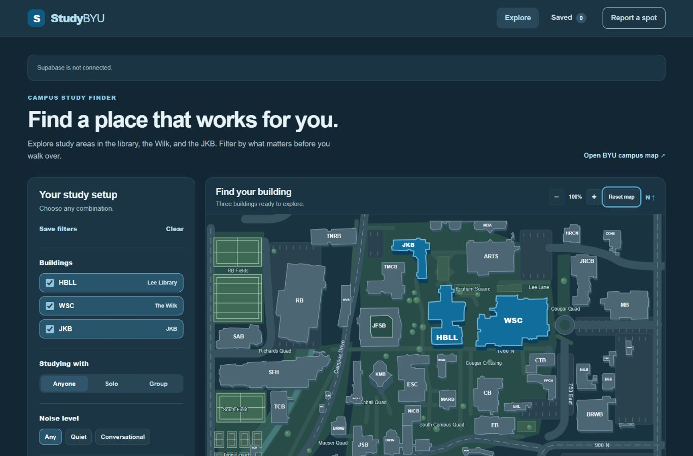
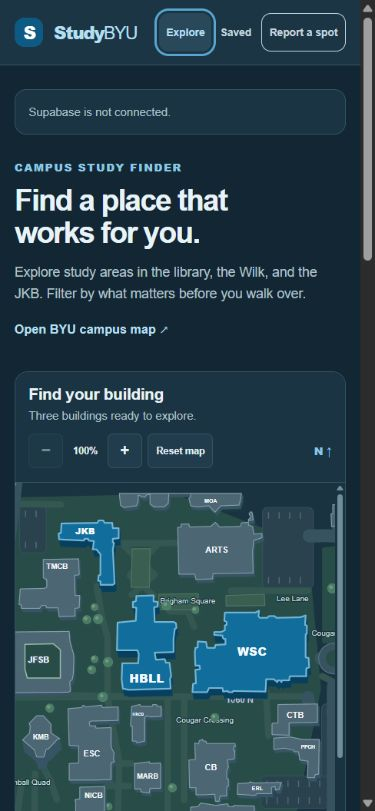

# Study BYU audit — October 27, 2026

Reviewed and refined the existing HTML/CSS/JavaScript app in place.

## Fixes

- Gave the filter heading and actions enough space; made navigation, floor controls, forms, empty states, and toasts fit narrow screens.
- Added dialog focus containment, background isolation, reliable focus return, a skip link, and selected states for assistive technology. Preserved focus when filters and floor controls update.
- Kept a suggestion's selected floor when its space type changes; disabled the unused group-capacity input for individual spots. Displayed saved location details in the spot dialog.
- Validated saved data on startup, recovered valid lists independently of damaged entries, retained the legacy WSC floor migration, and handled unavailable/full browser storage without claiming a successful save.
- Added distinct colors for busy and unknown statuses, visible keyboard focus for report choices, and semantic radio groups.
- Preserved the campus map's center during zoom and resizing. Avoided rebuilding hidden floor drawings on every full render.
- Kept recommendation copy accurate when the configured database cannot be reached.

## Verification

- `npm test`: **19 passed**. Includes new regression coverage for saved lists, custom spots, location notes, legacy floor IDs, local reports, and malformed saved data.
- `npm run test:integration`: **all four scripts passed**. Covers all 45 campus actions, 25 built-in spots, 23 floor views, filters, search, saved lists, suggestions, reporting, denied writes, duplicate submission, refresh persistence, schema constraints, and preservation of existing rows. New checks cover suggestion floor retention, modal background isolation, location details, and busy-status styling.
- Actual browser: all **23 floor views** at **390 × 844** and **1366 × 900**, with SVG geometry, room controls, and no page-wide horizontal overflow. Checked Explore at widths **320, 390, 768, 1024, and 1366**, plus building controls at 320, 768, and 1024.
- Actual browser: cross-floor/alphanumeric room search, floor/side keyboard navigation, room labels, map zoom/reset, unsupported-building messages, combined filters and empty results, favorite save/refresh/removal, list-name validation, reservation link presentation, suggestion floor retention, dialog Tab/Shift+Tab/Escape, and focus return.
- All 23 source PDFs and 23 bundled SVG files returned HTTP 200 with the expected content types from the local server.
- Browser inspection used the system's dark color scheme. This was a component and responsive audit, not a full screen-reader or Lighthouse certification.

## Remaining external blocker

The configured Supabase hostname does not resolve (`ENOTFOUND`), and read-only checks of `ReportSpotStatus` and `latest_report_spot_status` fail before reaching the API. A BYU hostname resolves from the same environment. The browser correctly shows **“Supabase is not connected.”** The exact cause of the Supabase hostname failure remains undetermined; verify the project's status and current URL in Supabase.

The database tests above use isolated fictional PostgreSQL fixtures. A live report write and refresh could not be verified during this audit. The existing `.env`, live schema, rows, and credentials were not changed. No public deployment or ZIP update was performed.

## Screenshots

